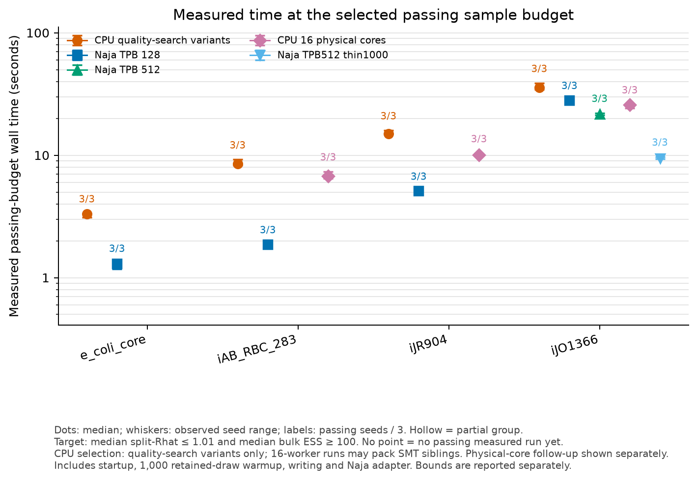
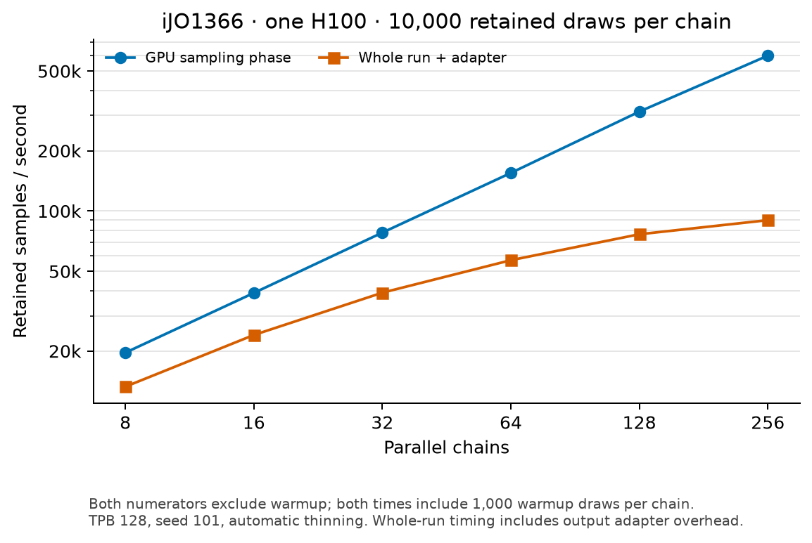

# Naja H100 benchmark status

Generated 2026-11-08T03:53:16+00:00. Values below come from saved run/metrics files; absent results remain absent.

Hardware/software: sampling runs use the Slurm node with Intel Xeon Platinum 8462Y+ CPUs (128 logical CPUs available) and one NVIDIA H100 80 GB HBM3 per GPU run, driver 580.126.20. Build toolkit: CUDA nvcc 12.9.86 (the driver reports CUDA 13.0 compatibility). CPU baseline: hopsy 1.7.0, PolyRound 0.5.0, COBRApy 0.32.1. Naja base SHA 23873f01d3268a79bbf84499a66adce5e88cc6cb plus saved localized patch; benchmark binary SHA256 c7baf4f0ed282b936ac0dbac4b896bfbfc040eb06da6f84aff6605fddf4b0fc6. [Captured environment](setup/h100-environment.txt).

## Matched protocol

One shared PolyRound-preprocessed polytope per model; 16 chains, 1,000 discarded retained-draw warmup, then 10,000 retained draws per chain. Planned seeds: 101, 202, 303. Raw BiGG bounds and medium are preserved; no objective/growth constraint is added. Preprocessing uses PolyRound/GLPK, independent of the expired Gurobi license.

Naja uses one H100, barrier rotation, automatic geometry-based thinning, zero global/delta relaxation, and no filtering before these diagnostics. hopsy uses uniform CHRR with 16 multiprocessing workers (not 128 active workers), plus explicitly labeled one-worker optimization runs where present; either API default thinning 1 or the recorded Jadebeck guideline ceil(d²/6). All samples are backmapped by the same affine transform for common reaction-space diagnostics.

Wall time includes model load, initialization, discarded warmup, sampling and output writing. Naja standardized-output conversion is also included conservatively in the primary wall comparison, but it is harness overhead (a second output copy), not required Naja work. Native CLI wall and adapter time are displayed separately. CPU full-process times include Python/NumPy/hopsy imports. Older CPU records lacking process_wall_seconds are explicitly marked startup-excluded and remain provisional; they are not pooled with full-process times or used in speedup ratios. Preprocessing and external diagnostics are reported separately/excluded equally. Naja native output is float32; hopsy output is float64. Timing scopes and phase times remain in each run.json.

Classical split-Rhat and ArviZ pooled rank-normalized bulk ESS are computed per reaction, excluding model-derived solver-detected nearconstant reactions (original-model GLPK min/max flux range ≤ 1e-7, feasibility tolerance 1e-9) plus exactly constant sampled reactions. The same cached model mask is used for both methods; legacy method-dependent 1e-12 numerical-range summaries remain in metrics.json for audit. Only schema-2 metrics with a verified model mask populate primary quality cells. Table cells are medians across completed seeds of each per-run statistic; Rhat p95 is the median across seeds of the within-run reaction p95. Bounds report the fraction of samples with any reaction-bound violation exceeding 1e-7, before filtering; exact zero-tolerance counts are preserved in metrics.json.

## Nine-model table

| Model | n / d / m | PolyRound s | Method | Actual thinning | Seeds complete / diagnosed | Matched wall s / timing scope | Naja native CLI s | Naja adapter s | Retained samples/s | Median Rhat | Rhat p95 | Median bulk ESS | Bound violation fraction | Status |
|---|---:|---:|---|---:|---:|---:|---:|---:|---:|---:|---:|---:|---:|---|
| e_coli_core | 95 / 24 / 36 | 0.3325 | naja | 50 | 3/3; 3 diagnosed | 2.083; naja_external_process_plus_normalization | 1.871 | 0.2408 | 7.68e+04 | 1 | 1.001 | 3.388e+04 | 0 | complete:3 |
| e_coli_core | 95 / 24 / 36 | 0.3325 | hopsy default | 1 | 3/3; 3 diagnosed | 7.292; cpu_full_process | — | — | 2.194e+04 | 1.034 | 1.064 | 627.8 | 0 | complete:3 |
| e_coli_core | 95 / 24 / 36 | 0.3325 | hopsy jadebeck | 96 | 3/3; 3 diagnosed | 6.997; cpu_full_process | — | — | 2.287e+04 | 1 | 1 | 5.764e+04 | 0 | complete:3 |
| e_coli_core | 95 / 24 / 36 | 0.3325 | hopsy default (1 worker) | 1 | 3/3; 3 diagnosed | 3.511; cpu_full_process | — | — | 4.557e+04 | 1.034 | 1.064 | 627.8 | 0 | complete:3 |
| e_coli_core | 95 / 24 / 36 | 0.3325 | hopsy jadebeck (1 worker) | 96 | 3/3; 3 diagnosed | 4.149; cpu_full_process | — | — | 3.856e+04 | 1 | 1 | 5.764e+04 | 0 | complete:3 |
| iAB_RBC_283 | 469 / 130 / 188 | 30.32 | naja | 50 | 3/3; 3 diagnosed | 2.649; naja_external_process_plus_normalization | 2.222 | 0.3694 | 6.04e+04 | 1.002 | 1.006 | 8542 | 0 | complete:3 |
| iAB_RBC_283 | 469 / 130 / 188 | 30.32 | hopsy default | 1 | 3/3; 3 diagnosed | 5.127; cpu_startup_excluded_provisional | — | — | 3.121e+04 | 1.429 | 1.965 | 39.62 | 0 | complete:3 |
| iAB_RBC_283 | 469 / 130 / 188 | 30.32 | hopsy jadebeck | 2817 | 3/3; 3 diagnosed | 17.98; cpu_full_process; cpu_startup_excluded_provisional; wall uses 2 full-process runs only | — | — | 8901 | 1 | 1 | 6.918e+04 | 0 | complete:3 |
| iAB_RBC_283 | 469 / 130 / 188 | 30.32 | hopsy default (1 worker) | 1 | 3/3; 3 diagnosed | 3.32; cpu_full_process | — | — | 4.819e+04 | 1.429 | 1.965 | 39.62 | 0 | complete:3 |
| iJR904 | 1075 / 232 / 291 | 45.04 | naja | 50 | 3/3; 3 diagnosed | 3.298; naja_external_process_plus_normalization | 2.772 | 0.526 | 4.851e+04 | 1.014 | 1.033 | 1417 | 0 | complete:3 |
| iJR904 | 1075 / 232 / 291 | 45.04 | hopsy default | 1 | 3/3; 3 diagnosed | 7.174; cpu_full_process; cpu_startup_excluded_provisional; wall uses 1 full-process runs only | — | — | 2.23e+04 | 2.296 | 2.919 | 22.34 | 0 | complete:3 |
| iJR904 | 1075 / 232 / 291 | 45.04 | hopsy jadebeck | 8971 | 3/3; 3 diagnosed | 61.04; cpu_full_process | — | — | 2621 | 1 | 1.001 | 4.982e+04 | 0 | complete:3 |
| iJR904 | 1075 / 232 / 291 | 45.04 | hopsy default (1 worker) | 1 | 3/3; 3 diagnosed | 3.741; cpu_full_process | — | — | 4.277e+04 | 2.296 | 2.919 | 22.34 | 0 | complete:3 |
| iAF1260 | 2382 / 524 / 671 | 131.3 | naja | 87 | 3/3; 3 diagnosed | 6.332; naja_external_process_plus_normalization | 5.526 | 0.8077 | 2.527e+04 | 1.025 | 1.073 | 821.4 | 0 | complete:3 |
| iAF1260 | 2382 / 524 / 671 | 131.3 | hopsy default | 1 | 3/3; 3 diagnosed | 10.51; cpu_full_process | — | — | 1.522e+04 | 3.093 | 4.313 | 19.14 | 0 | complete:3 |
| iAF1260 | 2382 / 524 / 671 | 131.3 | hopsy jadebeck | 45763 | 3/3; 3 diagnosed | 696.7; cpu_full_process | — | — | 229.6 | 1 | 1.001 | 4.804e+04 | 0 | complete:3 |
| iAF1260 | 2382 / 524 / 671 | 131.3 | hopsy default (1 worker) | 1 | 3/3; 3 diagnosed | 4.871; cpu_full_process | — | — | 3.284e+04 | 3.093 | 4.313 | 19.14 | 0 | complete:3 |
| iJO1366 | 2583 / 581 / 750 | 154.4 | naja | 96 | 3/3; 3 diagnosed | 6.893; naja_external_process_plus_normalization | 5.976 | 0.9162 | 2.321e+04 | 1.021 | 1.085 | 1015 | 0 | complete:3 |
| iJO1366 | 2583 / 581 / 750 | 154.4 | hopsy default | 1 | 3/3; 3 diagnosed | 9.483; cpu_full_process | — | — | 1.687e+04 | 3.145 | 4.259 | 19.09 | 0 | complete:3 |
| iJO1366 | 2583 / 581 / 750 | 154.4 | hopsy jadebeck | 56261 | 3/3; 3 diagnosed | 1043; cpu_full_process | — | — | 153.4 | 1 | 1.001 | 5.341e+04 | 0 | complete:3 |
| iJO1366 | 2583 / 581 / 750 | 154.4 | hopsy 100 | 100 | 3/3; 3 diagnosed | 12.14; cpu_full_process | — | — | 1.318e+04 | 1.175 | 1.398 | 86.44 | 0 | complete:3 |
| iJO1366 | 2583 / 581 / 750 | 154.4 | hopsy 500 | 500 | 3/3; 3 diagnosed | 18.89; cpu_full_process | — | — | 8470 | 1.038 | 1.072 | 557.7 | 0 | complete:3 |
| iJO1366 | 2583 / 581 / 750 | 154.4 | hopsy default (1 worker) | 1 | 3/3; 3 diagnosed | 4.931; cpu_full_process | — | — | 3.245e+04 | 3.145 | 4.259 | 19.09 | 0 | complete:3 |
| iML1515 | 2712 / 635 / 801 | 170.1 | naja | 105 | 3/3; 3 diagnosed | 7.94; naja_external_process_plus_normalization | 6.926 | 0.968 | 2.015e+04 | 1.017 | 1.068 | 1206 | 0 | complete:3 |
| iML1515 | 2712 / 635 / 801 | 170.1 | hopsy default | 1 | 3/3; 3 diagnosed | 18.48; cpu_full_process | — | — | 8660 | 3.226 | 4.438 | 18.84 | 0 | complete:3 |
| iML1515 | 2712 / 635 / 801 | 170.1 | hopsy jadebeck | 67205 | 3/3; 3 diagnosed | 1415; cpu_full_process | — | — | 113.1 | 1 | 1.001 | 5.304e+04 | 0 | complete:3 |
| iML1515 | 2712 / 635 / 801 | 170.1 | hopsy default (1 worker) | 1 | 3/3; 3 diagnosed | 5.107; cpu_full_process | — | — | 3.133e+04 | 3.226 | 4.438 | 18.84 | 0 | complete:3 |
| iMM904 | 1577 / 288 / 413 | 77.32 | naja | 50 | 3/3; 3 diagnosed | 3.625; naja_external_process_plus_normalization | 3.072 | 0.5657 | 4.414e+04 | 1.018 | 1.046 | 1155 | 0.02924 | complete:3 |
| iMM904 | 1577 / 288 / 413 | 77.32 | hopsy default | 1 | 3/3; 3 diagnosed | 7.932; cpu_full_process | — | — | 2.017e+04 | 2.3 | 3.226 | 22.07 | 0.02738 | complete:3 |
| iMM904 | 1577 / 288 / 413 | 77.32 | hopsy jadebeck | 13824 | 3/3; 3 diagnosed | 140.2; cpu_full_process | — | — | 1141 | 1 | 1.001 | 4.958e+04 | 0.02913 | complete:3 |
| iMM904 | 1577 / 288 / 413 | 77.32 | hopsy default (1 worker) | 1 | 3/3; 3 diagnosed | 4.505; cpu_full_process | — | — | 3.552e+04 | 2.3 | 3.226 | 22.07 | 0.02738 | complete:3 |
| RECON1 (precision-limited) | 3741 / 931 / 2120 | 1550 | naja | 155 | 3/3; 3 diagnosed | 18.4; naja_external_process_plus_normalization | 17.24 | 1.122 | 8696 | 1.057 | 1.163 | 315.6 | 0.5923 | complete:3 |
| RECON1 (precision-limited) | 3741 / 931 / 2120 | 1550 | hopsy default | 1 | 3/3; 3 diagnosed | 13.15; cpu_full_process | — | — | 1.217e+04 | 3.61 | 4.8 | 18.21 | 0.522 | complete:3 |
| RECON1 (precision-limited) | 3741 / 931 / 2120 | 1550 | hopsy jadebeck | 144461 | 2/3; 2 diagnosed | 8287; cpu_full_process | — | — | 19.31 | 1 | 1.001 | 5.743e+04 | 0.5919 | complete:2, running:1 |
| Recon3D | — / — / — | — | naja | — | 0/3; 0 diagnosed | — | — | — | — | — | — | — | — | preprocessing pending/missing |
| Recon3D | — / — / — | — | hopsy default | — | 0/3; 0 diagnosed | — | — | — | — | — | — | — | — | preprocessing pending/missing |
| Recon3D | — / — / — | — | hopsy jadebeck | — | 0/3; 0 diagnosed | — | — | — | — | — | — | — | — | preprocessing pending/missing |

RECON1 is precision-limited: its unchanged GLPK/presolve geometry passed a separately declared preprocessing verification gate of 1e-6; the strict 1e-7 check failed (center bound residual 1.1405e-7, pilot residual 1.5282e-7). This is not a relaxation of the sampling target: original bounds and arrays are unchanged. All common sample metrics still use 1e-7 and exact zero tolerance over every reaction. [Structured preprocessing attempts](setup/RECON1_preprocessing_attempts.json); strict failure evidence remains beside the model validation. CSV fields preserve the verification tolerance and strict-pass flag.

RECON1 output-bound warning: the preprocessing center/pilot tolerance does not guarantee later sample accuracy. Current float32 reduced-output Naja runs have maximum absolute reaction-bound violations seed 101: 0.0008416, seed 202: 0.001769, seed 303: 0.01651, substantially larger than the 1e-6 preparation gate. The approximately 0.59 any-reaction sample-violation fraction is largely associated with nearly blocked reactions, while the coordinate fraction is much smaller; the larger errors also affect varying reactions. The same-trajectory float64/export-quantization test below establishes export quantization as the cause of the large seed303 varying-reaction errors; small LP-excluded residuals remain in full precision. All unfiltered fractions/maxima remain in CSV/metrics; passing Rhat/ESS would not imply bound compliance.

Preprocessing hardware differs: e_coli_core was preprocessed once on the controller (Xeon Platinum 8562Y+); the other prepared models ran on the Slurm node (Xeon Platinum 8462Y+). These are individual recorded preparation times, not a controlled cross-model CPU scaling comparison. Per-model meta.json and all_runs.csv preserve preprocessing hostnames. All benchmark sampling uses the Slurm H100 node.

## Equal-sample speedups

Each row pairs the same model, seed, chain count, retained budget, warmup and reduced dimension. CPU is the fastest completed baseline with full-process timing for that seed; provisional CPU timings that exclude Python/package startup are excluded from speedup pairs. Both methods’ quality is shown; a speedup here is not an equal-quality claim. Missing CPU variants can change which baseline is fastest.

| Model | Seed | Fastest CPU / thinning | CPU wall s | Naja inclusive / native / adapter s | CPU/Naja | CPU Rhat / ESS | Naja Rhat / ESS |
|---|---:|---|---:|---:|---:|---:|---:|
| RECON1 | 101 | hopsy_chrr / default / workers=16 | 14.17 | 18.37 / 17.24 / 1.122 | 0.7718 | 3.545 / 18.3 | 1.057 / 315.6 |
| RECON1 | 202 | hopsy_chrr / default / workers=16 | 13.15 | 18.5 / 17.24 / 1.258 | 0.7107 | 3.668 / 18.18 | 1.06 / 305 |
| RECON1 | 303 | hopsy_chrr / default / workers=16 | 12.37 | 18.4 / 17.29 / 1.106 | 0.6725 | 3.61 / 18.21 | 1.057 / 319 |
| e_coli_core | 101 | hopsy_chrr / default / workers=1 | 2.926 | 2.753 / 2.421 / 0.3322 | 1.063 | 1.034 / 627.8 | 1 / 3.388e+04 |
| e_coli_core | 202 | hopsy_chrr / default / workers=1 | 3.575 | 2.062 / 1.821 / 0.2408 | 1.734 | 1.036 / 601 | 1.001 / 3.259e+04 |
| e_coli_core | 303 | hopsy_chrr / default / workers=1 | 3.511 | 2.083 / 1.871 / 0.2129 | 1.685 | 1.031 / 656.6 | 1 / 3.402e+04 |
| iAB_RBC_283 | 101 | hopsy_chrr / default / workers=1 | 3.32 | 3.341 / 2.972 / 0.3694 | 0.9938 | 1.406 / 39.73 | 1.002 / 8677 |
| iAB_RBC_283 | 202 | hopsy_chrr / default / workers=1 | 3.286 | 2.477 / 2.121 / 0.356 | 1.326 | 1.438 / 38.57 | 1.002 / 8505 |
| iAB_RBC_283 | 303 | hopsy_chrr / default / workers=1 | 3.833 | 2.649 / 2.222 / 0.4274 | 1.447 | 1.429 / 39.62 | 1.002 / 8542 |
| iAF1260 | 101 | hopsy_chrr / default / workers=1 | 4.449 | 6.332 / 5.526 / 0.8064 | 0.7026 | 3.136 / 19.14 | 1.024 / 832.4 |
| iAF1260 | 202 | hopsy_chrr / default / workers=1 | 4.871 | 6.483 / 5.626 / 0.8573 | 0.7514 | 3.093 / 19.01 | 1.028 / 799.1 |
| iAF1260 | 303 | hopsy_chrr / default / workers=1 | 5.172 | 6.234 / 5.426 / 0.8077 | 0.8296 | 3.029 / 19.23 | 1.025 / 821.4 |
| iJO1366 | 101 | hopsy_chrr / default / workers=1 | 4.534 | 6.905 / 5.976 / 0.9291 | 0.6566 | 3.014 / 19.15 | 1.022 / 935.5 |
| iJO1366 | 202 | hopsy_chrr / default / workers=1 | 4.931 | 6.893 / 5.976 / 0.9162 | 0.7153 | 3.145 / 19.09 | 1.02 / 1015 |
| iJO1366 | 303 | hopsy_chrr / default / workers=1 | 5.174 | 6.839 / 5.927 / 0.912 | 0.7565 | 3.181 / 19.05 | 1.021 / 1027 |
| iJR904 | 101 | hopsy_chrr / default / workers=1 | 3.585 | 3.766 / 3.222 / 0.5435 | 0.952 | 2.046 / 22.66 | 1.013 / 1465 |
| iJR904 | 202 | hopsy_chrr / default / workers=1 | 3.741 | 3.208 / 2.722 / 0.4861 | 1.166 | 2.349 / 22.13 | 1.014 / 1417 |
| iJR904 | 303 | hopsy_chrr / default / workers=1 | 3.877 | 3.298 / 2.772 / 0.526 | 1.176 | 2.296 / 22.34 | 1.014 / 1363 |
| iML1515 | 101 | hopsy_chrr / default / workers=1 | 5.107 | 7.94 / 6.926 / 1.014 | 0.6432 | 3.073 / 19.12 | 1.018 / 1209 |
| iML1515 | 202 | hopsy_chrr / default / workers=1 | 4.882 | 7.827 / 6.877 / 0.9501 | 0.6237 | 3.226 / 18.78 | 1.017 / 1154 |
| iML1515 | 303 | hopsy_chrr / default / workers=1 | 5.613 | 8.045 / 7.077 / 0.968 | 0.6977 | 3.296 / 18.84 | 1.017 / 1206 |
| iMM904 | 101 | hopsy_chrr / default / workers=1 | 3.742 | 3.625 / 3.072 / 0.5529 | 1.032 | 2.3 / 22.07 | 1.02 / 1115 |
| iMM904 | 202 | hopsy_chrr / default / workers=1 | 4.638 | 3.673 / 3.072 / 0.6011 | 1.263 | 2.393 / 21.5 | 1.018 / 1155 |
| iMM904 | 303 | hopsy_chrr / default / workers=1 | 4.505 | 3.537 / 2.972 / 0.5657 | 1.274 | 2.3 / 22.1 | 1.017 / 1168 |

## Naja native phase times (seconds)

Median per phase across completed canonical seeds. These internal profiler times exclude process startup and standardized-output conversion. Bins overlap: on the reduced rotated path, backtransform_s includes download_from_gpu_s. Do not sum phase columns or equate their sum with externally measured wall time.

| Model | Barrier | Load | Barrier | Upload | Sample | Download | Backtransform (overlapping) | Write | Internal total |
|---|---|---:|---:|---:|---:|---:|---:|---:|---:|
| e_coli_core | rotate | 0.0016 | 0.0361 | 0.0001 | 0.9599 | 0.0172 | 0.0284 | 0.0317 | 1.45 |
| iAB_RBC_283 | rotate | 0.0022 | 0.0794 | 0.0002 | 1.076 | 0.0935 | 0.0949 | 0.1277 | 1.772 |
| iJR904 | rotate | 0.0035 | 0.0744 | 0.0003 | 1.466 | 0.167 | 0.1686 | 0.2552 | 2.335 |
| iAF1260 | rotate | 0.0128 | 0.1357 | 0.0008 | 3.701 | 0.3654 | 0.3688 | 0.4395 | 5.063 |
| iJO1366 | rotate | 0.0139 | 0.1471 | 0.0008 | 4.092 | 0.4049 | 0.4095 | 0.4798 | 5.489 |
| iML1515 | rotate | 0.0183 | 0.1657 | 0.0008 | 5.036 | 0.4513 | 0.4563 | 0.4917 | 6.531 |
| iMM904 | rotate | 0.0053 | 0.0831 | 0.0003 | 1.656 | 0.2036 | 0.2056 | 0.2682 | 2.63 |
| RECON1 | rotate | 0.044 | 0.5254 | 0.0019 | 14.65 | 0.6356 | 0.6445 | 0.6412 | 16.82 |

## Model-derived diagnostic masks

Candidate selection uses max(abs(T row)) ≤ 1e-6, followed by original-model min/max GLPK LPs. Only successful solver-detected ranges ≤ 1e-7 are excluded; unresolved or wider ranges remain active. This does not modify sampling targets or any bound checks. Empirical backmapped ranges above the LP tolerance expose affine-transform numerical residue and remain visible here.

| Model | LP-nearconstant excluded / total | LP mask seconds | Maximum measured range among excluded reactions |
|---|---:|---:|---:|
| e_coli_core | 8 / 95 | 0.2262 | 2.521e-13 |
| iAB_RBC_283 | 16 / 469 | 0.3119 | 1.681e-12 |
| iJR904 | 409 / 1075 | 2.302 | 4.122e-08 |
| iAF1260 | 851 / 2382 | 8.577 | 8.652e-09 |
| iJO1366 | 878 / 2583 | 10.01 | 1.066e-11 |
| iML1515 | 968 / 2712 | 11.33 | 9.52e-08 |
| iMM904 | 693 / 1577 | 5.499 | 4.481e-07 |
| RECON1 | 1274 / 3741 | 24.21 | 3.267e-07 |
| Recon3D | pending | — | — |

## Failures and incomplete work

No failure/timeout run records found. Jobs terminated before writing run.json are not automatically counted as completed or failed; inspect saved Slurm logs.

## Measured time to quality

Criterion: masked median classical split-Rhat ≤ 1.01 and median pooled bulk ESS ≥ 100. These are separately executed exact-budget sampling times, including startup, 1,000 retained-draw warmup, writes and Naja adapter. Prefixes choose the budget; their interpolated times are not used. Search/diagnostic costs are excluded. The tested budget grid and CPU variants are finite, so these are not globally optimal stopping times. Bounds are checked separately from the convergence criterion.

[Measured quality records and per-seed comparisons](quality/summary.json). Incomplete seed groups remain explicitly incomplete. [Figure SVG](figures/measured_quality_time.svg) · [plotted source CSV](figures/measured_quality_source.csv).

| Model | Variant | Passing measured seeds | Median selected draws/chain | Median process wall s | Max sample bound violation fraction (1e-7) |
|---|---|---:|---:|---:|---:|
| e_coli_core | cpu_default1 | 3/3 | 5e+04 | 4.168 | 0 |
| e_coli_core | cpu_jade1 | 3/3 | 500 | 3.35 | 0 |
| e_coli_core | cpu_jade16 | 3/3 | 500 | 7.145 | 0 |
| e_coli_core | cpu_nativejade1 | 3/3 | 250 | 3.744 | 0 |
| e_coli_core | naja128 | 3/3 | 500 | 1.307 | 0 |
| iAB_RBC_283 | cpu_jade16 | 3/3 | 250 | 8.544 | 0 |
| iAB_RBC_283 | cpu_nativejade16 | 3/3 | 250 | 9.325 | 0 |
| iAB_RBC_283 | naja128 | 3/3 | 5000 | 1.862 | 0 |
| iJO1366 | cpu_fixed2000 | 2/3 | 1e+04 | 51.72 | 0 |
| iJO1366 | cpu_fixed500 | 3/3 | 5e+04 | 60.93 | 0 |
| iJO1366 | cpu_fixed5000 | 3/3 | 5000 | 61.24 | 0 |
| iJO1366 | cpu_jade16 | 3/3 | 500 | 157.1 | 0 |
| iJO1366 | cpu_native2000 | 3/3 | 1e+04 | 35.59 | 0 |
| iJO1366 | naja128 | 3/3 | 5e+04 | 27.98 | 0 |
| iJO1366 | naja512 | 3/3 | 5e+04 | 21.57 | 0 |
| iJO1366 | naja_tune_pair025 | 3/3 | 5e+04 | 21.72 | 1.25e-06 |
| iJO1366 | naja_tune_rotate_jacobi | 1/3 | 5e+04 | 31.84 | 0 |
| iJO1366 | naja_tune_whiten_jacobi | 1/3 | 5e+04 | 31.44 | 0 |
| iJR904 | cpu_jade16 | 3/3 | 500 | 14.98 | 0 |
| iJR904 | cpu_nativejade16 | 3/3 | 500 | 16.21 | 0 |
| iJR904 | naja128 | 3/3 | 2e+04 | 5.117 | 3.125e-06 |

## Empirical uniformity agreement

[Full marginal and correlation comparison](uniformity/summary.json). e_coli_core only: one million retained samples per method, two independently seeded hopsy references, Naja rotate, Naja whiten plus pair probability 0.5, and a separately verified whiten/Jacobi-pair/Dikin mixture (pair 0.5, Dikin 0.15, coordinate 0.35; 11 runtime directions). Common model-derived reaction mask. This tests empirical agreement on e_coli_core, not a general uniformity proof. [Mixture execution evidence](uniformity/naja_whiten_dikin_pair/mixture_verification.json).

| Comparison against hopsy reference 1 | Median W1 / reference std | p95 W1 / reference std | Correlation Frobenius distance |
|---|---:|---:|---:|
| hopsy2401 | 0.00241 | 0.006189 | 0.1561 |
| naja_rotate | 0.00241 | 0.005985 | 0.1829 |
| naja_whiten | 0.003201 | 0.006516 | 0.1804 |
| naja_whiten_dikin_pair | 0.003428 | 0.007828 | 0.1736 |

Active reactions: 87. The hopsy2401 row is the independent-reference floor. This artifact uses bound tolerance 1e-6; the fixed-budget/quality tables above use 1e-7, so their violation fractions have different definitions.

## H100 chain and thread-block scaling

[Full scaling timings and sampled telemetry](scaling/iJO1366/summary.json). iJO1366, seed 101, rotate, automatic thinning, 10,000 retained plus 1,000 warmup draws per chain; one factor changes at a time. These exploratory runs are excluded from the fixed-budget model table. [Figure SVG](figures/h100_chain_scaling.svg) · [plotted source CSV](figures/chain_scaling_source.csv).

| Case | Chains | TPB | Retained samples / sampling s | Native process s | Adapter s | Sampled peak GPU MiB |
|---|---:|---:|---:|---:|---:|---:|
| chains128 | 128 | 128 | 3.137e+05 | 10.93 | 5.78 | 1.303e+04 |
| chains16 | 16 | 128 | 3.9e+04 | 5.826 | 0.8271 | 2107 |
| chains256 | 256 | 128 | 5.971e+05 | 17.24 | 11.18 | 2.551e+04 |
| chains32 | 32 | 128 | 7.804e+04 | 6.527 | 1.655 | 3667 |
| chains64 | 64 | 128 | 1.55e+05 | 8.18 | 3.082 | 6787 |
| chains8 | 8 | 128 | 1.963e+04 | 5.475 | 0.5526 | 999 |
| tpb128 | 16 | 128 | 3.935e+04 | 5.975 | 0.9044 | 1389 |
| tpb256 | 16 | 256 | 5.407e+04 | 4.775 | 0.8339 | 1389 |
| tpb512 | 16 | 512 | 5.837e+04 | 4.574 | 0.8664 | 1389 |
| tpb64 | 16 | 64 | 2.521e+04 | 8.18 | 1.044 | 1389 |

Telemetry is sampled once per second and can miss memory peaks. Feasibility checks cover only 1,024 deterministic reduced-space samples per case at tolerance 1e-6; this section is throughput scaling, not an equal-quality comparison.

## CPU source-build optimization pilot (one seed)

[Three-way pilot CSV](native_cpu/pilot_table.csv) · [provenance and summary](native_cpu/pilot_summary.json). This is a separate iJO1366 seed101 build experiment: 16 chains, 10,000 retained plus 1,000 warmup draws, thinning 2,000. It is excluded from the frozen wheel-based canonical table. Native three-seed passing-budget measurements are reported only when completed; this pilot is not a three-seed fastest-CPU claim.

| Build | hopsy build ID | Flags | Process s | Sampling s | Median Rhat | Median bulk ESS | Bound violation fraction (1e-7) |
|---|---|---|---:|---:|---:|---:|---:|
| wheel | dadab7b | wheel defaults | 52.29 | 46.8 | 1.01 | 2192 | 0 |
| source_generic | 9b787d9 | -O3 | 51.01 | 44.13 | 1.01 | 2192 | 0 |
| native | 9b787d9 | -O3 -march=native -mtune=native | 36.96 | 31.39 | 1.01 | 2151 | 0 |

The controlled source_generic/native comparison uses the same official SDIST (build 9b787d9), GCC 11.4.0 and runtime; only native ISA/tuning flags differ. Observed native speedup: 1.380× process, 1.406× sampling. The installed wheel reports build dadab7b, so wheel/native differences alone do not isolate compiler flags. Analytic cube checks passed. Rhat is near the cutoff and changes slightly with floating-point trajectories; these results do not establish improved mixing.

## Experimental wide-index 512-chain probe

[Safe-build scaling summary](scaling-extension-safe/iJO1366/summary.json) · [build/correctness proof](safe-build-verification/wide-index-proof.json). This uses a separate cast-only wide-index binary, SHA256 `da263d6060416d96da366392210b9468422890bda8200718da452941436a8f18`; the canonical binary remains `c7baf4…`. Results are not pooled into the frozen canonical table or the original scaling curve.

| Case | Chains | TPB | Retained samples / sampling s | Native process s | Adapter s | Sampled peak GPU MiB |
|---|---:|---:|---:|---:|---:|---:|
| chains512_tpb128 | 512 | 128 | 1.117e+06 | 29.77 | 18.62 | 5.048e+04 |
| chains512_tpb512 | 512 | 512 | 4.589e+05 | 35.17 | 21.84 | 5.048e+04 |

At 512 chains TPB128 was faster than TPB512; the small-chain tuning result does not generalize automatically. These are single-pass throughput probes with full saved-array finite checks and only 1,024 sampled feasibility checks, not full-output convergence diagnostics. One-second memory peaks are sampled, not exact.

The original frozen-binary 512-chain attempts were invalid: signed 32-bit element-size products overflowed above INT_MAX, and CUDA/cuBLAS errors occurred despite process exit status zero. Those records remain [explicitly invalid](scaling-extension/iJO1366/summary.json) and supply no throughput evidence. The separate cast-only fix passed all five GPU tests and a same-seed BOX comparison bitwise. Runner guards now reject backend errors, unsupported INT_MAX products, nonfinite output and wrong dimensions; see [guard tests](runner-guards-test.log). The wide-index patch is scoped to the reduced-output path and does not claim all other large-array paths were widened.

## Paired reduced-export precision experiment

[Same-trajectory RECON1 seed303 evidence](precision/RECON1/seed303/summary.json) · [float64 build proof](f64-build-verification/verification.json). One unchanged double-precision trajectory is backmapped as T@Z64+shift and T@float64(float32(Z64))+shift, using float64 backmaps. The quantized trajectory reproduces the historical frozen float32 output bitwise. This isolates export quantization, rather than comparing different stochastic trajectories.

Maximum varying/nonexcluded reaction-bound error falls from 0.016507841 to 0; the float64 full-output maximum is 2.7091309e-07, confined to LP-excluded nearconstant reactions. At tolerance 1e-7, the unfiltered float64 any-reaction fraction remains 0.59409375. Float64 therefore resolves the observed large seed303 export errors, but does not establish strict 1e-7 compliance, eliminate geometry residue, or validate every model/seed. No bounds filtering or clipping was applied. The experimental binary is `5e6968eb7d3cebf5f27c16d2662a2e640cc3f6b7a633b7e7ae3bc9136a99f3d5`; canonical timings/results retain the frozen float32 build.

## Opt-in host first-touch experiment

[Three paired repetitions](host_prefault/iJO1366/summary.json) · [build proof](prefault-build-verification/verification.json). iJO1366, seed101, 512 chains, TPB128, 10,000 retained plus 1,000 warmup draws/chain; one H100 and eight allocated CPUs. Same experimental binary, fresh processes, alternating off/on, on/off, off/on order. All retained arrays are SHA256-identical. This is a throughput/transfer test, excluded from canonical quality comparisons.

Median download phase including allocation, first-touch threads, joins, tail-byte touch and cudaMemcpy: 12.6 → 2.958 s. Native process: 31.57 → 21.46 s; process plus normalization: 52.15 → 42.45 s. Median paired speedups are 4.394× download, 1.471× native process and 1.232× including normalization. The binary is `a656a1f93489af051acd540d08369092567dd0673af2b0e1ac922dc58a910603`; first-touch defaults off. This single model/seed result does not establish general speedup, convergence, or exact memory peaks.

## CPU physical-core placement control

The earlier 16-worker native CPU measurements reserved 16 logical CPUs, which can place sibling hardware threads on only eight physical cores. This separate placement control reserves 32 logical CPUs and pins 16 workers to one hardware thread on each of 16 physical cores. Same native build and iJO1366 thinning 2,000; 16 chains, 10,000 retained plus 1,000 discarded warmup draws/chain. It is excluded from the frozen canonical table and listed independently from packed-worker quality groups. The earlier 1.65× iJO1366 quality-search comparison uses the packed-worker CPU group; the physical-core comparison below supersedes it for a best-tested CPU claim.

| Seed | Process s | Masked median Rhat | Median bulk ESS | Bound fraction (1e-7) | Passing | Evidence |
|---|---:|---:|---:|---:|---|---|
| 101 | 25.8 | 1.009759 | 2151 | 0 | yes | [run/affinity](native_cpu/iJO1366/physical16_thin2000/seed101/physical_affinity.json) |
| 202 | 26 | 1.009846 | 2199 | 0 | yes | [run/affinity](native_cpu/iJO1366/physical16_thin2000/seed202/physical_affinity.json) |
| 303 | 24.31 | 1.009612 | 2164 | 0 | yes | [run/affinity](native_cpu/iJO1366/physical16_thin2000/seed303/physical_affinity.json) |

Completed verified passing physical-core seeds: 3/3. Three-seed ratios require all three seeds to pass. Full-process CPU timing includes imports, startup, warmup, sampling and writes. Affinity/resource metadata is retained per seed; node load remains shared.

Against these three physical-core CPU seeds, median CPU process wall is 25.8 s; Naja TPB512 median inclusive wall is 21.57 s. Median paired CPU/Naja ratio: 1.165×. GPU uses 50,000 retained draws/chain versus CPU 10,000; both meet the declared median criterion. This is a tested selected-budget comparison, not a global optimum.

## GPU thinning: newly measured selected budgets

[Sweep, pilot costs and preserved attempts](gpu_thinning/iJO1366/summary.json). iJO1366, frozen c7baf4 binary, 16 chains, TPB512, seeds 101/202/303. Every final is a fresh exact-budget process with fresh schema2 verified-mask diagnostics. Wall includes initialization, 1,000 discarded retained warmup draws/chain, sampling, writes and normalization. Pilot, prefix-search and diagnostic costs are excluded and recorded separately; changing thinning changes warmup move count.

| Thinning | Passing final seeds | Retained draws/chain | Median inclusive s | Median Rhat | Median bulk ESS | Max bound fraction (1e-7) |
|---:|---:|---:|---:|---:|---:|---:|
| 200 | 0/3 (pilot cap) | — | — | — | — | — |
| 500 | 3/3 | 5000 | 9.905 | 1.007879 | 2486 | 0 |
| 1000 | 3/3 | 2000 | 9.467 | 1.009705 | 2015 | 0 |

Best completed tested iJO1366 GPU configuration: thinning 1,000, TPB512, 2,000 retained draws/chain, median inclusive wall 9.46715 s versus physical-core native CPU 25.8015 s (10,000 retained draws/chain, thinning 2,000). Ratio of medians 2.7254×; median paired CPU/GPU 2.7466×. CPU uses 16 physical cores with 32 logical CPUs reserved, not all 128 logical CPUs. The earlier automatic-thinning 96 / 50,000-draw GPU result 21.5712 s is historical and superseded for best-tested quality timing. This is a selected-budget comparison, not equal sample count or a global optimum. Near-cutoff Rhat and tuning on the same three seeds motivate fresh nonoverlapping seeds for the separate 512-chain study underway; no result from that study is inferred here.

[Best-use-case interpretation and throughput limits](BEST_USE_CASE.md).

## Additional physical-core CPU controls

Matched wheel/native follow-ups reserve 32 logical CPUs and pin 16 workers to 16 physical cores. Only independently validated saved group summaries enter this table; configuration/build groups remain separate. These exact selected-budget executions retain discarded warmup, import/startup and write costs. They do not alter the frozen canonical table.

| Model | Build/configuration | Passing seeds | Median process s | Artifact |
|---|---|---:|---:|---|
| iAB_RBC_283 | physical16_native_jade | 3/3 | 6.726 | [validated group](native_cpu/iAB_RBC_283/physical16_native_jade/summary.json) |
| iAB_RBC_283 | physical16_wheel_jade | 3/3 | 8.815 | [validated group](native_cpu/iAB_RBC_283/physical16_wheel_jade/summary.json) |
| iJR904 | physical16_native_jade | 3/3 | 10.07 | [validated group](native_cpu/iJR904/physical16_native_jade/summary.json) |
| iJR904 | physical16_wheel_jade | 3/3 | 11.65 | [validated group](native_cpu/iJR904/physical16_wheel_jade/summary.json) |

## Limits on interpretation

- Prefix budgets (100, 250, 500, 1,000, 2,000, 5,000, 10,000 retained draws per chain) identify when median Rhat ≤ 1.01 and median bulk ESS ≥ 100 in the saved trajectory. Any prefix wall-time estimate is linear interpolation, not a measured time-to-quality experiment.
- Shared initial points with independent RNGs do not constitute overdispersed initialization. Rhat alone does not prove uniformity; analytic GPU tests and separate long-reference comparisons are required.
- This prototype uses the proposed public BiGG panel. New results do not independently verify historical paper runs; source provenance is saved in `audit/data_inventory.md`.
- MATLAB was not available in the compute-node PATH; hopsy is the current CPU baseline. No Dingo/COBRA benchmark is silently implied.
- The production knockout corpus rebuild is outside this prototype scope. Conditioned, ablation, uniformity and scaling experiments have separate artifacts; absence from this model table does not imply their results.
- Only results/naja/** and results/hopsy/** enter the fixed-budget table and its speedup pairs. Scaling, quality-budget, uniformity, seed-reproducibility and pilot families are excluded even when their seed/shape matches. Duplicate canonical configurations for the same seed are explicitly rejected. Exploratory runs are excluded from this table and retained in all_runs.csv.

GPU correctness: all five analytic/device tests passed with production `--use_fast_math`; see `logs/correctness-fastmath-255.log`. The benchmark binary SHA and localized source patch are preserved under results/.

[Independent final review](../audit/final_review.md).

Source records: `data/raw/manifest.json`, `data/models/*/meta.json`, `results/**/run.json`, `results/**/metrics.json`, `logs/`, and environment locks. Run `python summarize.py` and `python report.py` to regenerate.
